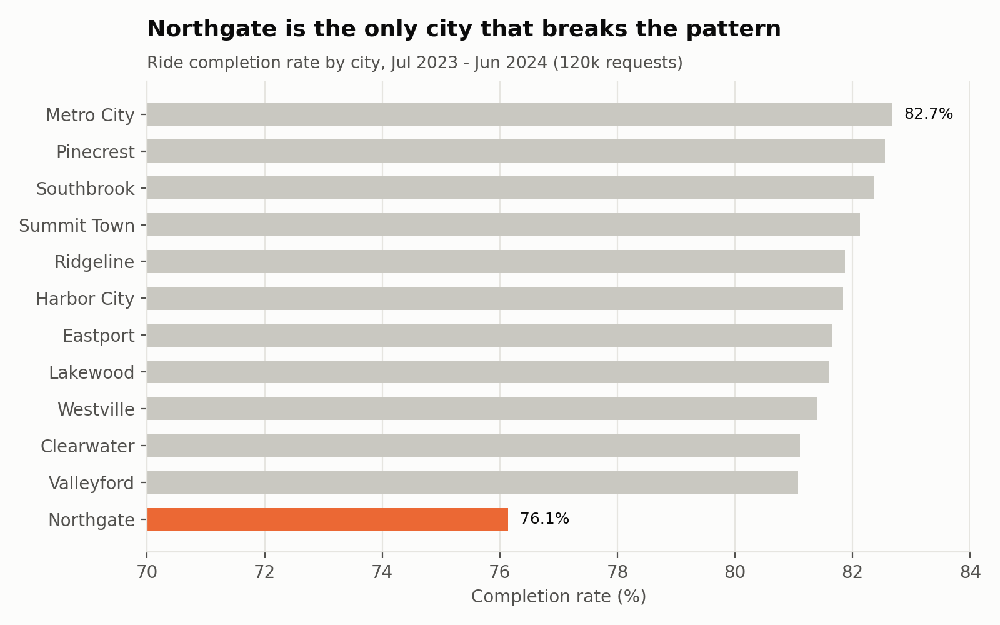
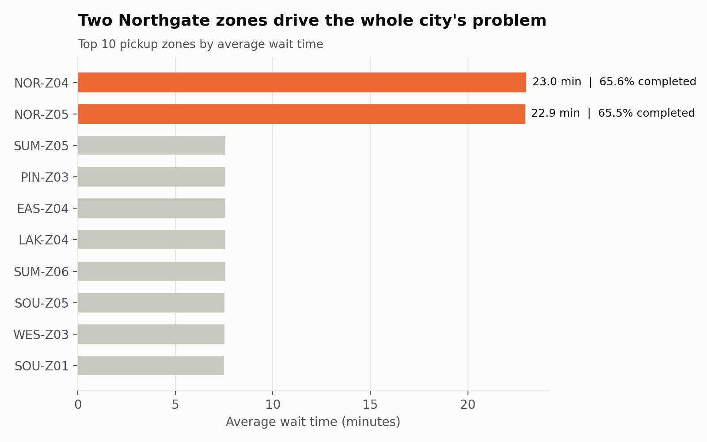
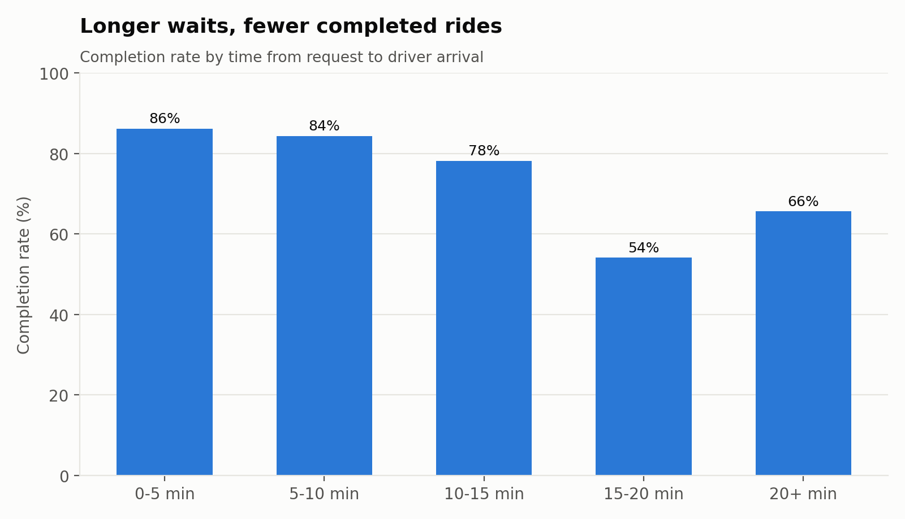
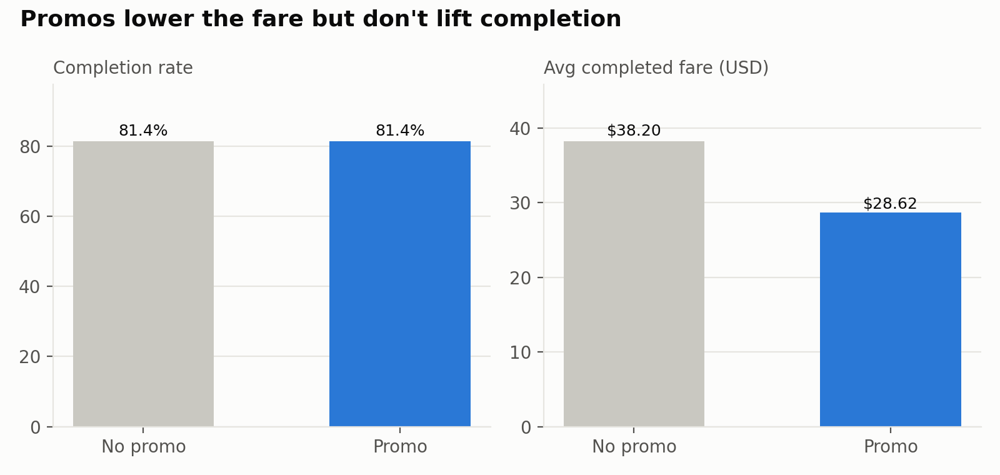
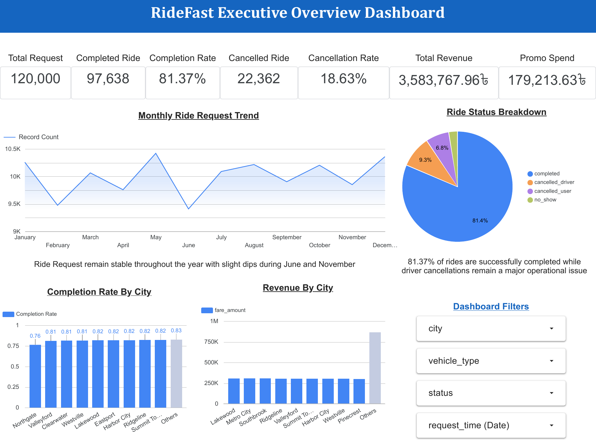
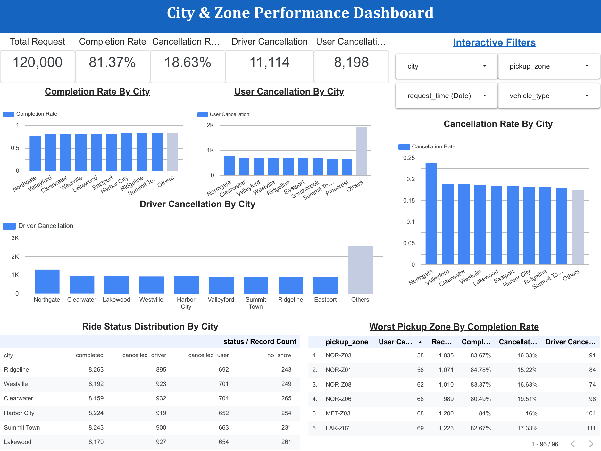
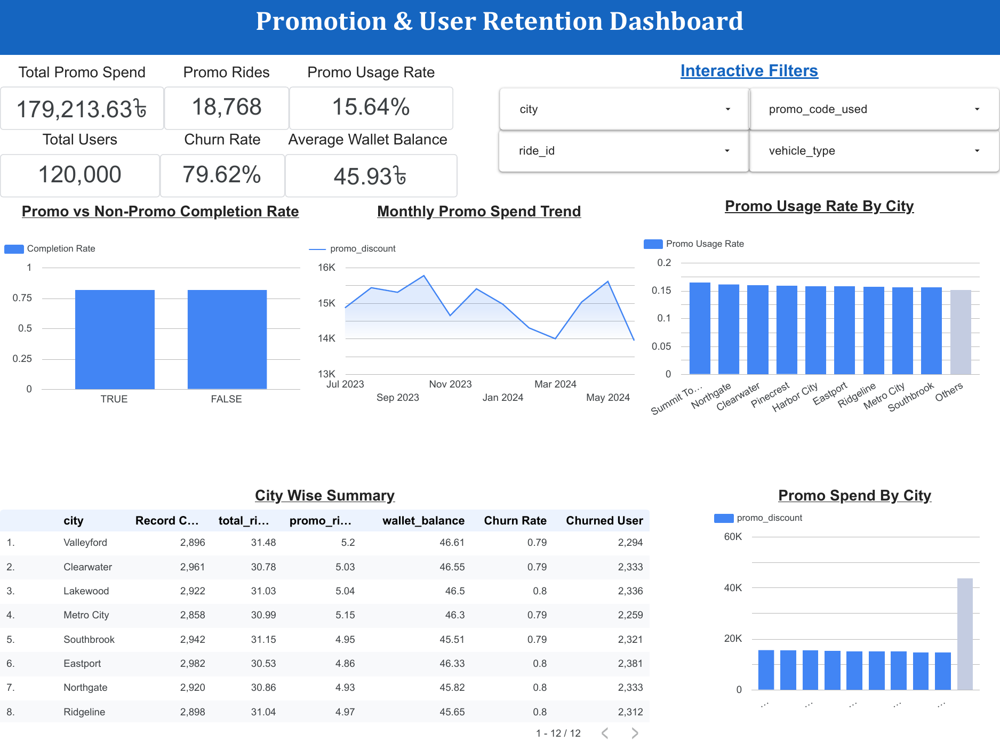
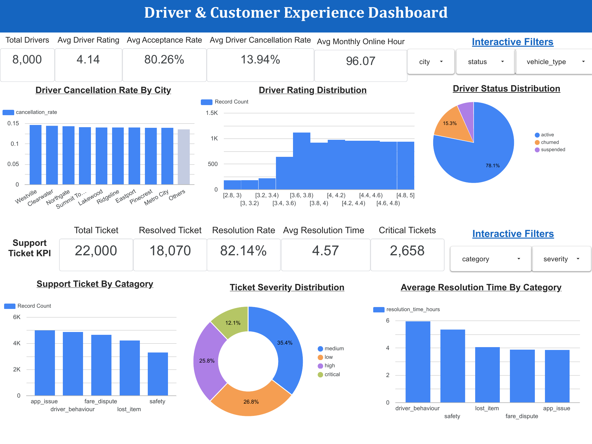

# RideFast BI Analysis — Diagnosing Ride Leakage, Promo Waste & Churn


End-to-end business intelligence case study on a ride-hailing platform: **120,000 ride requests, 35,000 users, 8,000 drivers and 22,000 support tickets across 12 cities** (Jul 2023 – Jun 2024).
I cleaned and modelled the data in Python and SQL, built a 4-page Looker Studio dashboard, and wrote a stakeholder report with five problems, their root causes and a prioritised action plan.

**[View the live dashboard](https://datastudio.google.com/reporting/50f61013-e060-4c96-a90e-3499e5fcca57)** · **[Read the full report (PDF)](reports/RideFast_BI_Report.pdf)** · **[Open the EDA notebook](notebooks/01_ridefast_eda.ipynb)**

---

## The business question

RideFast is growing, but leadership flagged warning signs threatening profitability and retention. The brief: find out **what is going wrong, where, and why**, and recommend data-backed actions.

## Key findings

| # | Finding | Evidence | Recommendation |
|---|---------|----------|----------------|
| 1 | **Northgate's problem is two zones, not the whole city** | Northgate completes 76.1% of requests vs 81.8% elsewhere, but 6 of its 8 zones are normal. `NOR-Z04` and `NOR-Z05` average **~23 min waits and ~65.5% completion** | Zone recovery plan: pre-peak driver positioning, dispatch-radius audit, pickup-time SLA. ≈607 rides / ≈$22k a year recoverable just by reaching network average |
| 2 | **Wait time drives failure** | Completion falls from **86% (<5 min wait) to 54% (15–20 min)**; driver cancellation triples | Wait-time alerts by zone × hour as the leading KPI |
| 3 | **Promotions subsidise, they don't convert** | Promo and non-promo requests both complete at **81.4%**; ~$179k in discounts; the fare gap ($9.58) ≈ the average discount ($9.55) | Stop blanket discounts; run segmented promos with holdout control groups and measure incremental rides per $ |
| 4 | **Retention is the biggest strategic risk** | **79.6%** of registered users have churned (no ride in 60 days) | Lifecycle program: onboarding, service-recovery offers after bad trips, targeted win-back |
| 5 | **Support friction erodes trust** | 22k tickets, **17.9% unresolved**; driver-behaviour tickets take 5.9 h to resolve | Map app issues to releases; SLA and escalation for safety & driver-behaviour cases |

<p align="center">
  
  
</p>
<p align="center">
  
  
</p>

## Dashboard

Built in **Looker Studio**: 4 interactive pages with city, zone, vehicle type, status, promo, category and date filters.

➡️ **[Open the live dashboard](https://datastudio.google.com/reporting/50f61013-e060-4c96-a90e-3499e5fcca57)** · **[Download as PDF](reports/RideFast_Looker_Studio_Dashboard.pdf)**



<table>
  <tr>
    <td width="33%"></td>
    <td width="33%"></td>
    <td width="33%"></td>
  </tr>
  <tr>
    <td align="center"><b>City & Zone Performance</b><br>completion, cancellation & worst pickup zones</td>
    <td align="center"><b>Promotion & User Retention</b><br>promo spend, promo vs non-promo, churn by city</td>
    <td align="center"><b>Driver & Customer Experience</b><br>driver quality, support tickets, resolution time</td>
  </tr>
</table>

## Approach

```
Raw CSVs ──► Validate (13 data-quality checks) ──► Feature engineering ──► KPI tables ──► Looker Studio
                                                     wait time, trip time,          │
                                                     hour, wait bucket ...          └──► Report & recommendations
```

1. **Data quality** — primary/foreign-key integrity, status values, time ordering, fare and rating rules (all 13 checks pass).
2. **Feature engineering** — wait time (request → pickup), trip duration, request hour/weekday/month, wait-time buckets, completion flags.
3. **Diagnostic analysis** — funnel by status, city → zone drill-down, wait-time buckets, promo vs non-promo, active vs churned users, ticket categories, driver supply by city.
4. **Metric framework** — completion rate, driver cancellation rate, avg/median wait, completed revenue, avg fare, promo usage, churn rate, ticket unresolved rate.
5. **Recommendations** — Stop / Start / Continue framework and a 5-step priority plan with owners, timelines and success metrics (see report).

## Repository structure

```
ridefast-bi-analysis/
├── data/
│   ├── raw/                  # source CSVs (rides, drivers, users, support_tickets)
│   └── processed/            # KPI tables exported for the dashboard
├── notebooks/
│   └── 01_ridefast_eda.ipynb # exploratory analysis, step by step
├── src/
│   ├── pipeline.py           # load → validate → engineer → aggregate → export
│   ├── charts.py             # charts used in this README
│   └── run_sql.py            # runs the SQL layer on an in-memory SQLite DB
├── sql/
│   └── kpi_queries.sql       # 8 KPI queries (funnel, city, zone, wait, promo, churn, support, supply)
├── images/                   # exported charts
├── reports/
│   ├── RideFast_BI_Report.pdf              # problems, root causes, action plan
│   └── RideFast_Looker_Studio_Dashboard.pdf # 4-page dashboard export
├── dashboard/                # dashboard page screenshots
└── requirements.txt
```

## Run it yourself

```bash
git clone https://github.com/<your-username>/ridefast-bi-analysis.git
cd ridefast-bi-analysis
pip install -r requirements.txt

python src/pipeline.py   # data-quality report, KPI tables, charts
python src/run_sql.py    # same KPIs, computed in SQL
```

## Data

| Table | Rows | Grain |
|-------|------|-------|
| `rides.csv` | 120,000 | one ride request |
| `drivers.csv` | 8,000 | one driver |
| `users.csv` | 35,000 | one registered user |
| `support_tickets.csv` | 22,000 | one support ticket |

Full column dictionary: [`data/README.md`](data/README.md). The dataset is synthetic and was provided as part of a BI Analyst case assessment; "RideFast" is a fictional company.

## Tools

Python (pandas, NumPy, Matplotlib) · SQL · Looker Studio · Jupyter

## Author

**Md. Rezwan Hossain Turjo** — Product & Data Analytics
[LinkedIn](https://www.linkedin.com/in/<your-profile>) · [Email](mailto:<your-email>)
