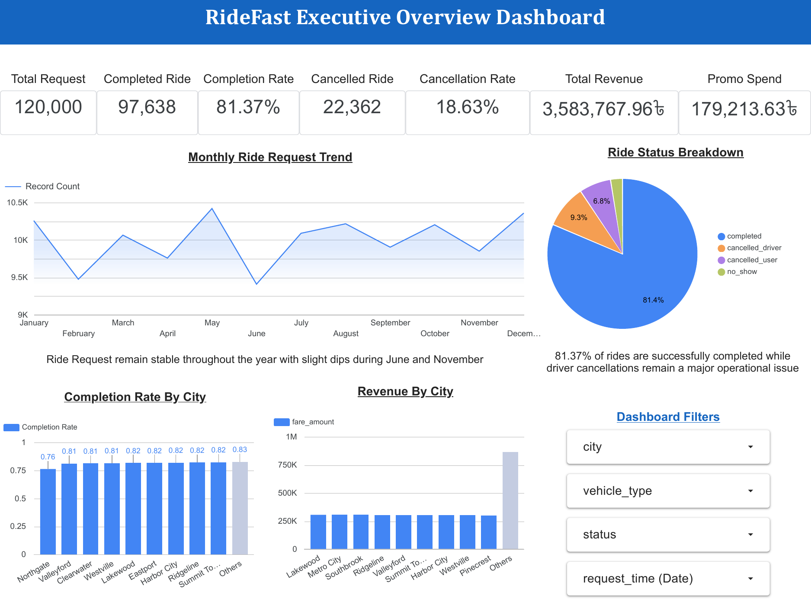
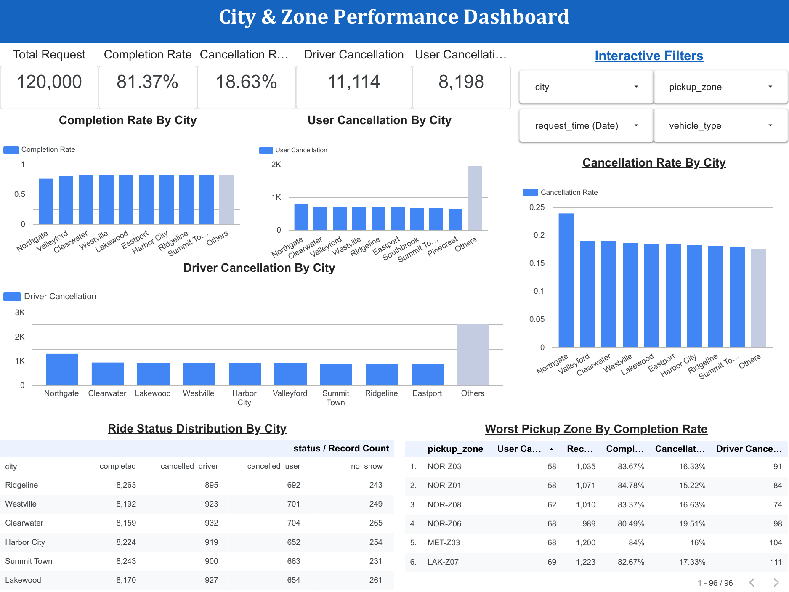
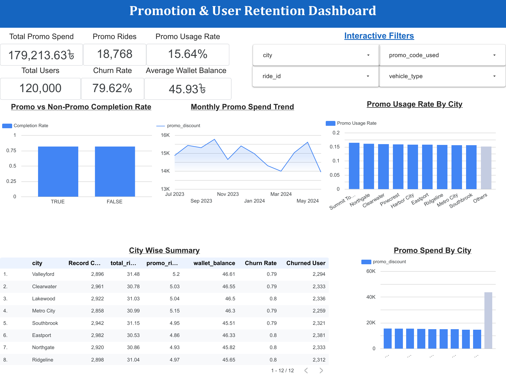
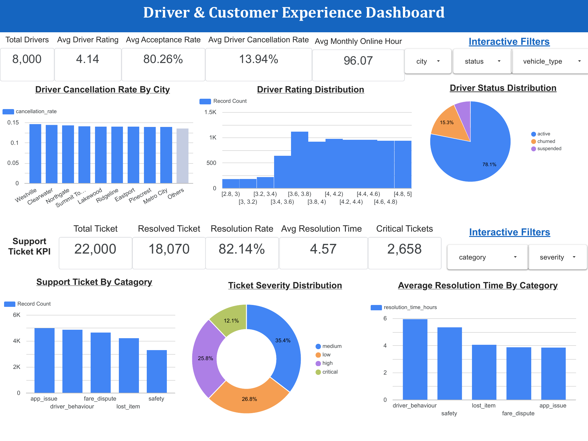

# Looker Studio dashboard

**Live link:** https://datastudio.google.com/reporting/50f61013-e060-4c96-a90e-3499e5fcca57
**PDF export:** [`reports/RideFast_Looker_Studio_Dashboard.pdf`](../reports/RideFast_Looker_Studio_Dashboard.pdf)

| Page | What it answers | Filters |
|---|---|---|
| 1. Executive Overview | Requests, completion & cancellation rate, revenue, promo spend, monthly trend, status mix, city completion & revenue | city, vehicle type, status, date |
| 2. City & Zone Performance | Where rides fail: completion, user/driver cancellation by city, status by city, pickup-zone table | city, pickup zone, vehicle type, date |
| 3. Promotion & User Retention | Promo spend & usage, promo vs non-promo completion, monthly promo spend, city-wise churn & wallet balance | city, promo used, vehicle type |
| 4. Driver & Customer Experience | Driver rating, acceptance, cancellation, status; support tickets by category & severity, resolution time | city, status, vehicle type, category, severity |

## 1. Executive Overview

## 2. City & Zone Performance

## 3. Promotion & User Retention

## 4. Driver & Customer Experience

Data sources: `data/raw/*.csv`, with `data/processed/rides_enriched.csv` (generated by `python src/pipeline.py`) for wait-time fields.
